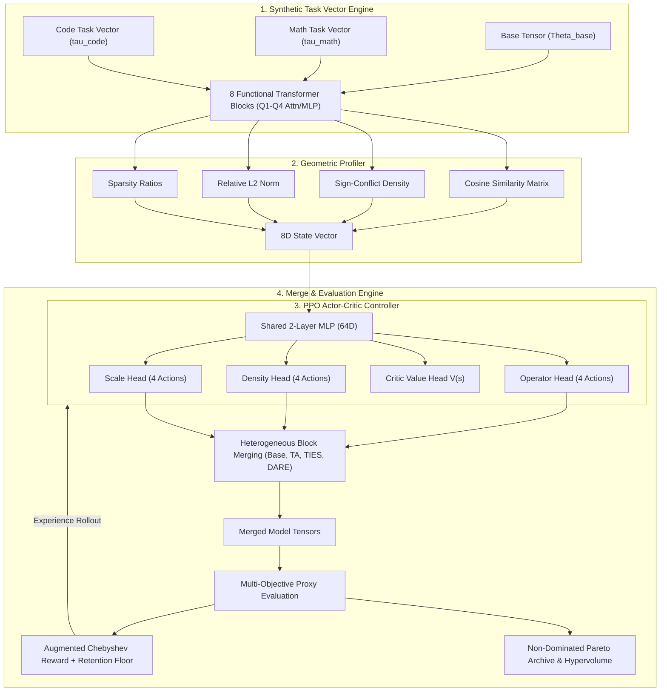

# ATLAS-MERGE: Automated Multi-Objective Model Merging via Task Vector Geometry

[](https://www.python.org/)
[](https://pytorch.org/)
[](https://streamlit.io/)
[](LICENSE)

**ATLAS-MERGE** is an interactive, simulation-first research system that automatedly discovers optimal, block-wise model merge recipes across competing task objectives using **task-vector geometry** and **Proximal Policy Optimization (PPO)** reinforcement learning.

> [!NOTE]
> **Research Demonstration Notice**: This system is designed as a **simulation-first research testbed**. It runs genuine PyTorch tensor operations and executes actual mathematical algorithms (TIES, DARE-TIES, Cosine Geometry, PPO Actor-Critic, Augmented Chebyshev Scalarization, and 2D Hypervolume). It does **not** require downloading multi-gigabyte LLM checkpoints or specialist LoRAs, enabling fast, zero-cost, reproducible experimentation on commodity hardware (Intel Core i5, 16 GB RAM, RTX 3050 Laptop GPU / CPU execution).

---

## 1. System Architecture



---

## 2. Core Mathematical Formulations

### A. Task Vector Geometry Metrics

For task vectors $\tau_1$ and $\tau_2$ within functional block $b$:

1. **Cosine Similarity**:
   $$\cos(\tau_1, \tau_2) = \frac{\langle \tau_1, \tau_2 \rangle}{\|\tau_1\|_2 \|\tau_2\|_2 + \epsilon}$$
   Measures directional collinearity ($\approx +1$ aligned, $\approx 0$ orthogonal, $\approx -1$ opposing).

2. **Sign-Conflict Density**:
   $$\text{Conflict}(\tau_1, \tau_2) = \frac{\sum_{j=1}^N \mathbb{I}(|\tau_{1, j}| > \theta \land |\tau_{2, j}| > \theta \land \tau_{1, j} \cdot \tau_{2, j} < 0)}{\sum_{j=1}^N \mathbb{I}(|\tau_{1, j}| > \theta \land |\tau_{2, j}| > \theta) + \epsilon}$$
   Calculates the fraction of active coordinates where updates push in conflicting opposite directions.

3. **Relative L2 Norm**:
   $$\text{RelNorm} = \frac{\|\tau_2\|_2}{\|\tau_1\|_2 + \epsilon}$$

4. **Coordinate Sparsity**:
   $$\text{Sparsity}(\tau) = \frac{1}{N} \sum_{j=1}^N \mathbb{I}(|\tau_j| \le \theta_{sparse})$$

---

### B. Merge Operators

1. **BASE-PRESERVE**:
   $$\theta_{merged} = \theta_{base}$$
2. **TASK ARITHMETIC**:
   $$\theta_{merged} = \theta_{base} + \lambda \sum_{i=1}^M w_i \tau_i$$
3. **TIES (Trim, Elect Sign, & Merge)**:
   - **Trim**: Retain top $(100 \times d)\%$ coordinates by absolute magnitude per task vector $\to \hat{\tau}_i$.
   - **Sign Election**: Compute majority sign $S_j = \text{sgn}\left(\sum_{i=1}^M \hat{\tau}_{i, j}\right)$.
   - **Sign-Compatible Aggregation**: Discard updates conflicting with $S_j$, and compute mean over compatible coordinates:
     $$\tau^{agg}_j = \frac{1}{|K_j|} \sum_{i \in K_j} \hat{\tau}_{i, j} \quad \text{where } K_j = \{i : \text{sgn}(\hat{\tau}_{i, j}) = S_j\}$$
   - **Merge**: $\theta_{merged} = \theta_{base} + \lambda \tau^{agg}$.
4. **DARE-TIES (Drop And REscale with TIES)**:
   - Drop coordinates with probability $1 - d$ (keep probability $p = d$).
   - Rescale kept coordinates by $\frac{1}{p}$.
   - Apply TIES aggregation on the rescaled updates.

---

### C. Multi-Objective Reward: Augmented Chebyshev Scalarization

To explore the true non-convex Pareto frontier without falling into weakly Pareto-optimal solutions, ATLAS-MERGE employs **Augmented Chebyshev Scalarization** coupled with a strict retention floor penalty:

Given:
- Mathematical reasoning proxy $f_{math} \in [0, 1]$
- Code generation proxy $f_{code} \in [0, 1]$
- Preference weights $\mathbf{w} = (w_{math}, w_{code})$ where $w_{math} + w_{code} = 1.0$
- Ideal / Utopia point $\mathbf{z}^* = (1.0, 1.0)$
- Augmentation coefficient $\rho = 0.05$
- Retention constraint floor $\tau_{ret} = 0.90$
- Penalty weight $\beta_{ret} = 5.0$

**Step 1: Weighted Chebyshev Distance**:
$$d_\infty(\mathbf{f}, \mathbf{w}) = \max \Big( w_{math} (z^*_{math} - f_{math}), \; w_{code} (z^*_{code} - f_{code}) \Big)$$

**Step 2: Augmented Chebyshev Term**:
$$R_{chebyshev} = - d_\infty(\mathbf{f}, \mathbf{w}) + \rho \cdot \Big( w_{math} f_{math} + w_{code} f_{code} \Big)$$

**Step 3: Retention Floor Penalty**:
$$P_{ret} = \beta_{ret} \cdot \max\left(0, \; \tau_{ret} - f_{ret}\right)$$

**Step 4: Total Scalar Reward**:
$$R = \begin{cases} R_{chebyshev} - P_{ret} & \text{if candidate is numerically valid} \\ -10.0 & \text{if NaN / Inf detected} \end{cases}$$

---

### D. PPO Reinforcement Learning Optimization

The PPO agent parameters $\theta$ are trained using clipped surrogate policy loss and value regression:
$$L^{CLIP}(\theta) = - \hat{\mathbb{E}}_t \left[ \min\left(r_t(\theta) \hat{A}_t, \; \text{clip}(r_t(\theta), 1 - \epsilon, 1 + \epsilon) \hat{A}_t \right) \right]$$
$$L^{VF}(\theta) = \frac{1}{2} \hat{\mathbb{E}}_t \left[ (V_\theta(s_t) - G_t)^2 \right]$$
$$S[\pi_\theta] = \hat{\mathbb{E}}_t \left[ H(\pi_{op}) + H(\pi_{den}) + H(\pi_{scale}) \right]$$
$$\text{Total Loss} = L^{CLIP}(\theta) + c_1 L^{VF}(\theta) - c_2 S[\pi_\theta]$$

Where:
- $\epsilon = 0.2$ (Clipping parameter)
- $c_1 = 0.5$ (Value loss coefficient)
- $c_2 = 0.01$ (Entropy bonus coefficient)
- $\gamma = 1.0$ (Undiscounted finite episode horizon)

---

## 3. Project Directory Structure

```
atlas-merge/
│
├── app.py                      # Multi-page Streamlit research application
├── requirements.txt            # Python dependencies
├── README.md                   # Complete academic & architectural documentation
│
├── config/
│   └── default_config.yaml     # System & hyperparameter configuration
│
├── core/
│   ├── synthetic_data.py       # Deterministic FP32 specialist task vector generation
│   ├── geometry.py             # Cosine, sign-conflict, relative norm, sparsity profiler
│   ├── merge_operators.py      # Base-Preserve, Task Arithmetic, TIES, DARE-TIES, SLERP
│   ├── merge_engine.py         # Multi-block heterogeneous merge coordinator
│   ├── ppo_agent.py            # Trainable Actor-Critic PPO controller in PyTorch
│   ├── reward.py               # Augmented Chebyshev scalarization & retention constraint
│   ├── pareto.py               # Dominance checking, archive pruning, & 2D hypervolume
│   ├── evaluation.py           # Grounded synthetic proxy evaluation
│   └── experiment.py           # End-to-end experiment orchestrator
│
├── dashboard/
│   ├── components.py           # Custom CSS, dark research UI, metric cards, hardware detection
│   └── charts.py               # Plotly 8x4 heatmaps, Pareto scatter, HV curves, PPO loss
│
├── utils/
│   ├── logging_utils.py        # Structured logging and JSONL writer
│   ├── validation.py           # FP32 tensor integrity, NaN/Inf checks, action validation
│   └── export.py               # JSON and CSV export utilities
│
├── tests/
│   ├── test_geometry.py        # Unit tests for geometry metrics (orthogonal, opposing, aligned)
│   ├── test_merge_operators.py # Unit tests for merge operators (TIES trimming, DARE expectation)
│   ├── test_ppo.py             # Unit tests for actor-critic network and weight updates
│   ├── test_pareto.py          # Unit tests for dominance and exact analytical hypervolume
│   └── test_integration.py     # End-to-end multi-episode search pipeline integration tests
│
├── data/
│   ├── synthetic/              # Synthetic tensor checkpoints
│   └── experiments/            # Saved search trials
│
└── outputs/
    ├── checkpoints/            # PPO weights and training traces (JSONL)
    ├── plots/                  # Generated figures
    └── reports/                # Exported CSV / JSON experiment summaries
```

---

## 4. Installation & Setup

### Prerequisites
- Windows 10/11 (or Linux/macOS)
- Python 3.10+ (tested on Python 3.12)

### Quickstart Setup
```bash
# 1. Navigate to workspace
cd "c:\Users\Devarajan\Desktop\mini project\atlas-merge"

# 2. Activate existing virtual environment (or create if needed)
# On Windows PowerShell:
.\.venv\Scripts\Activate.ps1

# 3. Ensure dependencies are satisfied
pip install -r requirements.txt
```

---

## 5. Running the Test Suite

Run the comprehensive pytest suite:
```bash
pytest -v
```

All 25 tests validate:
- ✅ Cosine similarity of identical, orthogonal, and opposing vectors
- ✅ Sign-conflict density calculation
- ✅ Relative L2 norm and sparsity
- ✅ NaN / Inf numerical guards
- ✅ TIES magnitude trimming and majority sign election
- ✅ DARE-TIES unbiased expectation $\mathbb{E}[(M \odot x)/p] = x$
- ✅ Base-Preserve zero-delta property
- ✅ PPO action validity and active weight updates during training
- ✅ Exact analytical 2D hypervolume calculation
- ✅ Automatic pruning of dominated Pareto candidates
- ✅ End-to-end multi-episode search execution and export

---

## 6. Launching the Interactive Dashboard

Launch the Streamlit research interface:
```bash
streamlit run app.py
```

The application will launch and be available locally at:
👉 **`http://localhost:8501`**

---

## 7. Faculty Demonstration Walkthrough

When presenting this project to faculty or research reviewers, follow this sequential walkthrough:

1. **Page 1: Overview**
   - Present the research motivation: merging specialists without destructive interference.
   - Show the 8 functional blocks and hardware detection confirming CPU/GPU execution mode.
2. **Page 2: Model Configuration**
   - Emphasize the simulation-first approach: explaining that real PyTorch tensors are used without wasting disk space on multi-gigabyte Qwen model downloads.
3. **Page 3: Geometry Profiler**
   - Display the **8x4 Geometry Heatmap**.
   - Point out that **Q1 Attention** has high positive alignment ($\cos \approx +0.77$) whereas **Q2 MLP** has severe sign conflict ($\cos \approx -0.73$, Conflict $> 80\%$). This justifies why a single global merge operator fails!
4. **Page 4: Merge Engine**
   - Perform an interactive manual merge on **Q2 MLP** using Task Arithmetic vs TIES.
   - Show how TIES trims conflicting gradients and eliminates destructive noise.
5. **Page 5: PPO Search**
   - Set PPO Episode Budget to 20 episodes.
   - Click **Run PPO Search Experiment**.
   - Show the live progress bar and watch the PPO Actor-Critic update its policy in real time, increasing Chebyshev reward and adapting operator distributions.
6. **Page 6: Pareto Explorer**
   - Inspect the **2D Pareto Frontier** (Math vs Code Proxy).
   - Point out the non-dominated star markers and step frontier.
   - Select a candidate to inspect its discovered block-wise recipe.
7. **Page 7: Evaluation**
   - Review the candidate's block-wise alignment scores.
   - Explain the transparent synthetic proxy design and discuss the real-world benchmark integration roadmap.
8. **Page 8: Experiment Logs**
   - Click **Download Experiment Logs as CSV** and **Download Full Trace as JSON** to demonstrate reproducible artifact generation.

---

## 8. Current Limitations & Real-Model Integration Roadmap

### Current Simulation Boundary
- **Tensors**: Simulated FP32 parameter matrices ($128 \times 128$) capturing attention and MLP functional blocks.
- **Proxies**: Mathematical reasoning and code proxies are grounded in tensor projection and conflict dynamics rather than live multi-hour GSM8K / MBPP generative sampling.

### Production Integration Roadmap
1. **Model Checkpoint Ingestion**: Integrate HuggingFace `transformers` and `peft` to extract LoRA weight updates from `Qwen/Qwen2.5-0.5B-Instruct`.
2. **Layer-to-Block Mapping**: Group transformer layers into 8 functional blocks (e.g. Layers 0-5 Attention, Layers 0-5 MLP, etc.).
3. **Surrogate-Assisted Search**: Use an active learning Gaussian Process or Neural Surrogate to predict GSM8K / MBPP scores from the 8D geometric state, reducing real GPU inference overhead during PPO rollouts.
4. **Multi-GPU Parallelism**: Deploy vLLM or Ray to parallelize benchmark evaluations across clusters.

